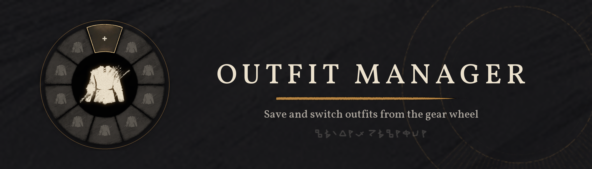
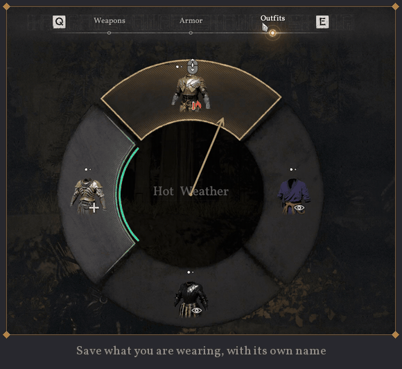
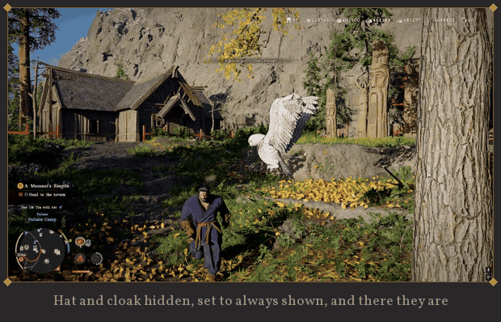

  <b>Save and switch outfits from Crimson Desert's gear wheel.</b> 
  <a href="https://www.nexusmods.com/crimsondesert/mods/4029"><b>Download on Nexus Mods</b></a>

---

This repository hosts the images used on the [Outfit Manager](https://www.nexusmods.com/crimsondesert/mods/4029)
mod page. The mod itself, its source code and its changelog are on Nexus.

## What the mod does

- **An Outfits tab in the gear wheel**, next to Weapons and Armour: save what you're wearing with one click and keep
  up to 11 outfits per character.
- **One-click switching.** Missing pieces are fetched from your bags, storage, the wardrobe or your party.
- **Kliff, Damiane and Oongka** each keep their own outfits, separately for every save.
- **Visibility per outfit:** every piece and weapon can be always shown, always hidden, shown only in combat or
  hidden in combat. Keep the armour, choose the look.

## Folders

| Folder | Used for |
|---|---|
| [`description/`](description) | the mod page's description, numbered in page order: header, separators, screenshots and GIFs |
| [`page/`](page) | the page banner, cover, thumbnail and logos |
| [`files/`](files) | the description images of the main file and the source download |
| [`posts/`](posts) | images for the pinned posts (bug reports) |

## Credits and licence

Page art built from Crimson Desert's own UI art and its UI font (Vollkorn by Friedrich Althausen, SIL Open Font
License); screenshots and GIFs are from the game. Crimson Desert and its content belong to Pearl Abyss.
The mod is released under the MIT licence; see its Nexus page.

Made by Strahlimeier.
